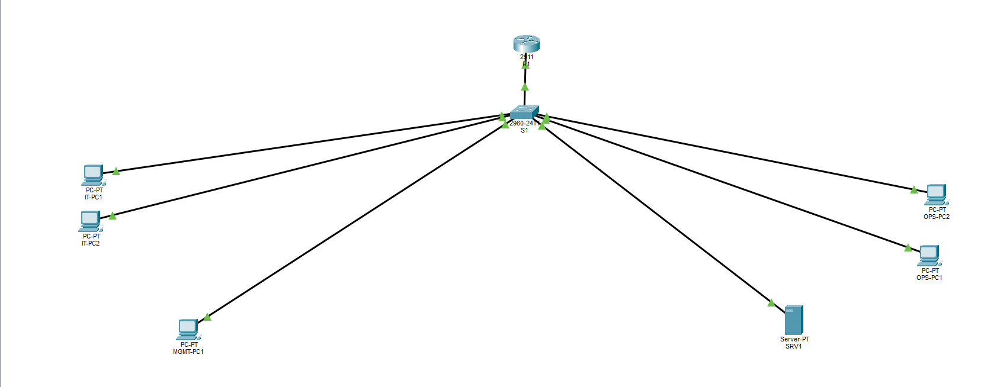

# 🌐 NOVA Small Business Network

### CCNA Practical Networking Project | Cisco Packet Tracer

A small business network design and configuration project demonstrating practical networking concepts, network segmentation, inter-VLAN routing, DHCP services, and access control security.

---

## 📌 Project Overview

The NOVA Small Business Network project focuses on designing and implementing a structured network infrastructure for a small business environment.

The network uses VLAN segmentation to organize departments and Router-on-a-Stick to enable communication between VLANs.

The project also implements DHCP, static server addressing, and Extended Access Control Lists (ACLs) to improve network management and security.

---

## 🖥️ Network Topology

---

## 🛠️ Network Devices

| Device | Model | Quantity |
|---|---|---:|
| Router | Cisco 2811 | 1 |
| Switch | Cisco 2960-24TT | 1 |
| PCs | PC-PT | 5 |
| Server | Server-PT | 1 |

---

## 🔧 Technologies & Configurations

- **VLANs:** Network segmentation using four VLANs.
- **Router-on-a-Stick:** Inter-VLAN routing configuration.
- **802.1Q Trunking:** VLAN traffic transmission between network devices.
- **DHCP:** Automatic IP address assignment to client devices.
- **Static Server IP:** Manual IP configuration for the server.
- **Extended ACL:** Traffic filtering and network access control.

---

## 🧪 Testing & Verification

The following tests were performed:

- Inter-VLAN connectivity testing.
- DHCP address assignment verification.
- Server connectivity testing.
- Extended ACL security testing.
- Network communication verification.

---

## 📂 Project Files

| File | Description |
|---|---|
| `NOVA-Small-Business-Network.pkt` | Cisco Packet Tracer project |
| `NOVA-Network-Topology.png` | Network topology diagram |
| `README.md` | Project documentation |

### 📥 Download Project

[Download Cisco Packet Tracer Project](NOVA-Small-Business-Network.pkt)

---

## 🎯 Learning Objectives

- Network design and segmentation.
- VLAN configuration and management.
- Inter-VLAN routing.
- DHCP configuration.
- Network access control.
- Network connectivity testing and troubleshooting.

---

## 👩‍💻 Author

**Elaf Felemban**

CCNA Certified | Aspiring Network Engineer

Jeddah, Saudi Arabia

---

## 📫 Contact Me

- 📧 Email: [elaffelemban@hotmail.com](mailto:elaffelemban@hotmail.com)
- 💼 LinkedIn: [Elaf Felemban](https://www.linkedin.com/in/elaffelemban)
- 🐙 GitHub: [@elaffelemban](https://github.com/elaffelemban)

Feel free to contact me for professional opportunities and networking collaborations.

---

⭐ Thank you for visiting my project!
